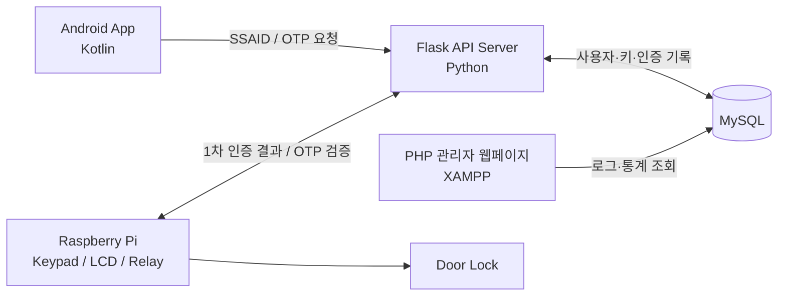
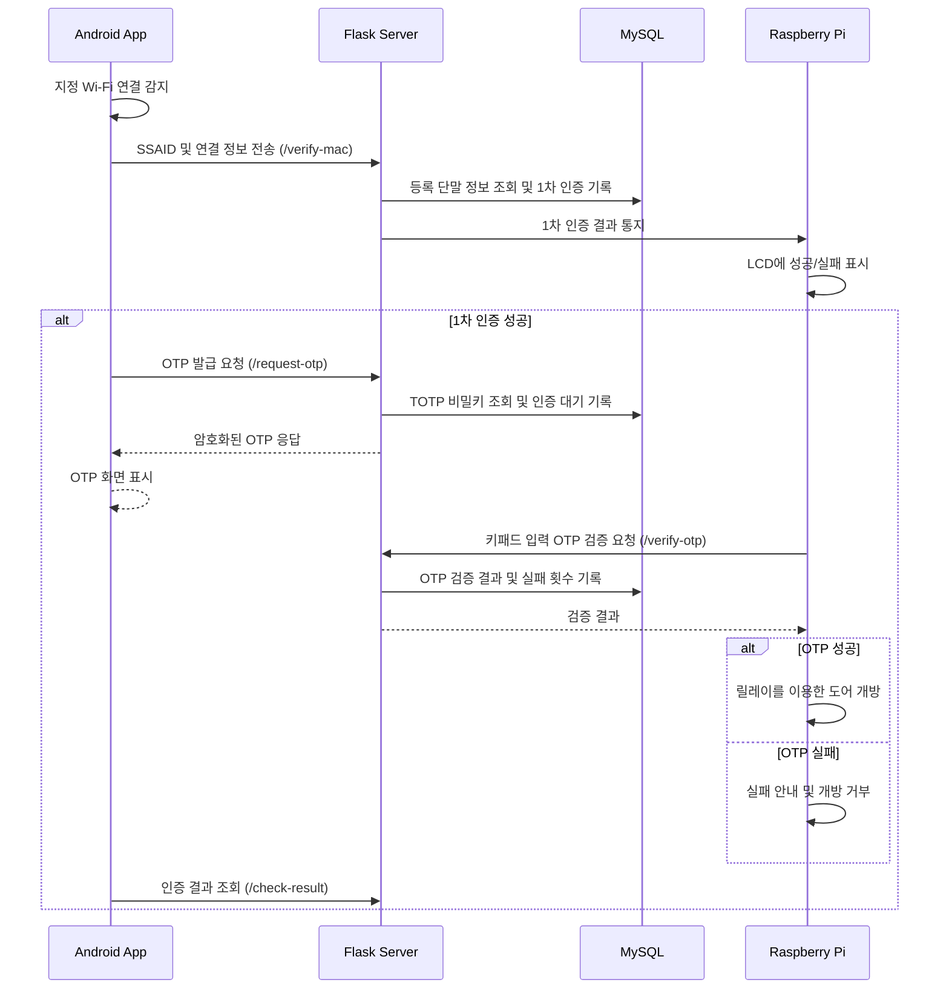

# 2FA-DuoGate

> **DuoGate** | Android SSAID와 TOTP 기반 이중 인증(2FA) IoT 출입통제 시스템
>
> *Two-Factor Authentication Access Control System using Android, Flask, and Raspberry Pi*

## 1. 프로젝트 개요

**2FA-DuoGate**는 Android 애플리케이션, Python Flask 서버, Raspberry Pi 출입 제어 장치, MySQL 데이터베이스 및 PHP 관리자 페이지를 연동한 **2단계 인증(2FA) 기반 출입 통제 시스템**입니다. 앱이 지정된 Wi-Fi에 연결되면 백그라운드 서비스가 단말 식별 정보를 전송해 1차 인증을 요청합니다. 이후 서버에서 발급한 시간 기반 OTP를 Raspberry Pi 키패드로 입력하고 검증하여 도어 개방 여부를 결정합니다.


## 2. 시스템 아키텍처



| 구성 요소 | 기술 | 역할 |
|---|---|---|
| Android App | Kotlin / Android | 회원가입·로그인, Wi-Fi 감지, SSAID 전송, OTP 수신 및 결과 표시 |
| Server | Python / Flask | 단말 인증, RSA/AES 처리, OTP 발급·검증, 인증 이력 저장 |
| Raspberry Pi | Python / Flask / RPi.GPIO | 인증 결과 수신, LCD 표시, 키패드 입력, 부저·릴레이·도어 제어 |
| Database | MySQL | 사용자, 장치, 키, 1차·2차 인증 및 도어 개방 기록 |
| WebPage | PHP / XAMPP | 관리자 로그인, 단계별 인증 로그 및 성능 통계 조회 |

## 3. 인증 흐름



### 1차 인증: 단말 식별

`FirstAuth.kt`의 Android `Service`가 Wi-Fi 연결 정보를 확인하고, 설정된 SSID에 연결되면 `Settings.Secure.ANDROID_ID`(SSAID)를 읽어 `/verify-mac` API로 전송합니다. 서버는 등록된 단말 정보와 비교해 결과를 기록하고 Raspberry Pi로 통지합니다. **API 명칭은 `verify-mac`이지만 Android 코드가 전송하는 핵심 식별값은 SSAID이므로, 이를 스마트폰의 물리적 Wi-Fi MAC 주소 인증과 동일하게 설명하지 않습니다.**

### 2차 인증: TOTP

서버의 `/request-otp`는 등록된 사용자 TOTP 비밀키를 이용해 OTP를 생성하고 앱에 암호화하여 전달합니다. 사용자는 Raspberry Pi 키패드에 OTP를 입력하고, `/verify-otp`가 이를 검증합니다. 서버 코드에는 인증 실패 횟수 누적 및 계정 잠금 처리가 포함되어 있습니다.

## 4. 저장소 구조

```text
2FA-DuoGate/
├── App/
│   ├── 2faAccessSystem.zip       # Android Studio 프로젝트 원본
│   └── app-debug.apk             # 테스트용 APK
├── DB/
│   ├── DBschema.sql              # DB 스키마
│   └── EERD_0529_최종.jpg         # ER 다이어그램
├── RaspberryPI/
│   ├── flask_thread.py           # 1차 인증 결과 수신 서버 (5001)
│   └── RPi_0601.py               # 키패드/LCD/부저/릴레이 제어
├── Server/
│   ├── api/                      # Flask API 엔드포인트
│   ├── config/                   # 설정
│   ├── model/                    # DB 연결
│   ├── utils/                    # RSA/AES/TOTP 유틸리티
│   └── requirements.txt
└── WebPage/
    ├── 2FA-Admin-Login.php
    ├── 2FA-View-Log.php
    └── get_s1T.php ~ get_s4T.php
```

Android 프로젝트의 핵심 코드는 `app/src/main/java/com/example/a2faaccesssystem/`에, 레이아웃 XML은 `app/src/main/res/layout/`에 있습니다. `FirstAuth.kt`, `OtpVerifyActivity.kt`, `AesUtil.kt`, `RSAUtil.kt` 등이 주요 파일입니다.

## 5. 주요 서버 API

| Method | Endpoint | 기능 |
|---|---|---|
| POST | `/check-id` | 사용자 ID 중복 확인 |
| POST | `/register-user` | 사용자 등록 |
| POST | `/register-mac` | 단말 정보 등록 |
| POST | `/login` | 로그인 |
| POST | `/issue-key` | 암호화 키 발급 처리 |
| POST | `/register-pi` | Raspberry Pi 장치 등록 |
| POST | `/verify-mac` | 1차 단말 인증 |
| POST | `/request-otp` | OTP 발급 요청 |
| POST | `/verify-otp` | 키패드 입력 OTP 검증 |
| GET | `/check-result` | 2차 인증 결과 조회 |
| POST | `/open-record` | 도어 제어 기록 |

## 6. 데이터베이스

`DB/DBschema.sql`에 정의된 테이블:

- `devices`: 출입 제어 장치 정보
- `users`: 사용자 및 등록 단말 정보
- `keys`: 암호화 관련 키·TOTP 비밀정보
- `firstauth`: 1차 인증 결과 및 세션 정보
- `secondauth`: 2차 인증 결과 및 실패 횟수
- `openrecord`: 도어 제어 기록

관리자 페이지에서는 전체 인증, 1차 인증, 2차 인증, 도어 제어의 로그와 성공률·처리 시간·지연 관련 통계를 확인하도록 구성했습니다.

## 7. 실행 방법

### 7.1 MySQL

MySQL에 프로젝트용 데이터베이스를 생성한 뒤 `DB/DBschema.sql`을 가져옵니다. DB 연결 설정은 `Server/model/db.py` 및 PHP 파일에서 **로컬 환경에 맞게 수정**해야 합니다. 공개 저장소에는 실제 계정 비밀번호를 포함하지 않습니다.

### 7.2 Flask 서버

```bash
cd 2FA-DuoGate/Server
python -m venv .venv
# Windows
.venv\Scripts\activate
# macOS/Linux
# source .venv/bin/activate
pip install -r requirements.txt
python -m api.app
```

개발용 서버의 코드상 바인딩 주소는 `0.0.0.0:5000`입니다. 실제 배포 시 `debug=True`를 비활성화하고 적절한 WSGI 서버 및 HTTPS 구성을 적용해야 합니다.

### 7.3 Raspberry Pi

Raspberry Pi에서 GPIO·I2C LCD 드라이버와 하드웨어 배선 및 서버 주소를 구성합니다. 먼저 1차 인증 결과 수신기를 실행한 다음 메인 제어 프로그램을 실행합니다.

```bash
cd RaspberryPI
python3 flask_thread.py
# 별도 터미널
python3 RPi_0601.py
```

`flask_thread.py`는 코드상 포트 `5001`을 사용합니다. `RPi_0601.py`는 Raspberry Pi 전용 `RPi.GPIO`와 별도의 LCD 드라이버 경로를 사용하므로 일반 PC에서는 그대로 동작하지 않습니다.

### 7.4 Android

`App/2faAccessSystem.zip`을 압축 해제하여 Android Studio에서 엽니다. `BuildConfig.BASE_URL`, `BuildConfig.WIFI_SSID` 등 개발 환경별 값을 확인하고 Android 기기에서 빌드·실행합니다. `app-debug.apk`는 개발용 빌드이며 배포용 서명 APK가 아닙니다.

### 7.5 관리자 웹페이지

XAMPP에서 Apache와 MySQL을 실행하고 `WebPage/`의 PHP 파일을 웹 루트(`htdocs`)에 배치합니다. PHP의 DB 연결 설정을 맞춘 뒤 `http://localhost/2FA-Admin-Login.php` 등 실제 배치 경로에 맞게 접속합니다.

## 8. 암호화 및 보안 고려사항

- 서버에는 RSA 암·복호화, AES 암·복호화, TOTP 유틸리티가 분리되어 있습니다.
- 초기 통신 및 키 관리에는 RSA, 인증 데이터 교환에는 AES를 활용하는 구조입니다. 구체적인 키 교환과 저장 경로는 실제 코드 및 배포 설정에 따라 검증해야 합니다.
- **공개 전 필수:** `Server/key/private.pem`, `Server/key/pi_aes.key`, 운영 DB 자격 증명, API 주소·기타 비밀 설정을 저장소에서 제외합니다. 이미 사용한 키는 교체합니다.
- `__pycache__/`, `*.pyc`, 빌드 산출물, 로그와 로컬 설정 파일을 `.gitignore`에 추가합니다.
- 서버 코드에 남은 OTP 평문 출력, 인증 입력값 출력, `debug=True`를 제거하거나 비활성화합니다.
- SSAID는 단말 식별 수단이지 강한 암호학적 소유 증명은 아닙니다. Wi-Fi SSID 일치 또한 물리적 근접성을 보증하지 않습니다.
- 현재 소스는 졸업작품 시연을 위한 코드로, 실서비스 운영 전 통신 보안·인증 세션·키 수명주기·비밀정보 관리·장애 시 잠금 정책에 대한 별도 보안 검토가 필요합니다.

**권장 `.gitignore` 예시:**

```gitignore
__pycache__/
*.py[cod]
.venv/
.env
.env.*
!.env.example
Server/key/
*.pem
*.key
.gradle/
build/
**/build/
local.properties
.idea/
*.log
```


---

> **프로젝트명:** 2FA-DuoGate (DuoGate)  
> **프로젝트 성격:** 학부 졸업작품 / 연구·교육 목적의 프로토타입. 실제 출입 통제 시설에 그대로 배포하는 것을 전제로 하지 않습니다.
